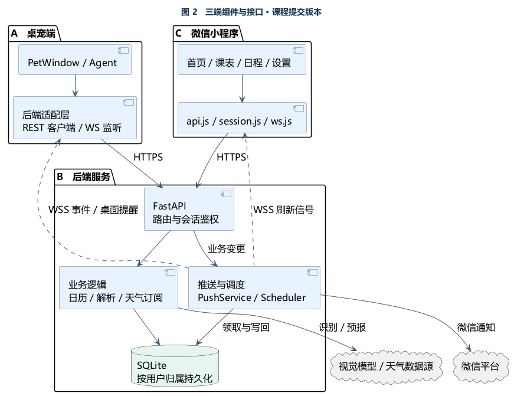

# 智能桌宠 · Intelligent Desk Pet

[](https://github.com/Yunkimo/Intelligent-Desktop-Pet/actions/workflows/ci.yml?query=branch%3Adevelop)
[](LICENSE)
[](https://www.python.org/)

一个面向学习和日常安排的三端协作课设。你可以对桌宠说「明晚七点提醒我交作业」，在微信小程序里查看或修改这条日程，到点由后端向在线桌宠推送提醒。小程序也支持拍照导入课表、查看明日天气和订阅微信带伞提醒。

[快速开始](#快速开始) · [三端演示](#三端演示) · [测试与验收](#测试与验收) · [课程设计与 UML](https://github.com/Yunkimo/Intelligent-Desktop-Pet/blob/cde778e7484bb964bfbca144a28ddecffd4157f5/docs/course-design/README.md)

## 功能特性

| 端 | 能做什么 |
| --- | --- |
| **桌宠端** | 文字和语音对话、流式气泡和语音播报。通过 Agent 查课表、管理日程、设置提醒、查天气和搜索。支持切换图片与人设、托盘、久坐提醒、Claude Code / Codex 状态角标，以及 Token 用量和估算费用查看。 |
| **后端** | 管理课程、日程、学期设置和提醒，按账号隔离数据。提供课表图片识别、自然语言日程解析、次日天气、实时事件和到期调度。日程与关联提醒在同一事务中更新，支持每周重复提醒。 |
| **微信小程序** | 查看今日与每周课表，增删改课程与日程，设置学期，拍照识别课表或输入一句话生成日程草稿。确认草稿后保存，支持微信登录、桌宠配对、日程订阅和带伞订阅。 |

### 账号与跨端同步

小程序通过微信登录识别个人账号。登录后进入「学期设置」，生成 **6 位数字配对码**，在桌宠的「后端账号」窗口输入完整数字。配对码 **90 天内有效、只能使用一次**，重新生成后旧码失效。配对成功后，桌宠使用独立的设备会话访问同一账号，设备会话默认 30 天。退出或重新绑定保留原有课表与日程。

详见 [账号契约](docs/b8-accounts.md) 和 [用户手册](docs/user-manual.md#后端账号绑定a19)。

### 文字录入

绑定同一账号后，可以直接对桌宠说话、在桌宠输入框键入，或在小程序「日程 → ＋」输入一句话。后端区分待办、日程和提醒。日程有开始时刻或待办有具体截止时刻时，若未指定提醒，创建前会询问，默认建议提前 1 小时。比如「明早九点开会，提前十分钟提醒我」会创建九点的日程及关联提醒。「明天三点交报告」会先请你选定时间的用途，再同步到两个端。小程序的批量解析仍可用来编辑多条草稿。

多用户部署在后端环境中设置 `ALLOW_LEGACY_API_KEY=false`，小程序用微信登录，桌宠用该账号的配对码登录。

### 提醒在哪里看到

| 场景 | 入口与触发条件 |
| --- | --- |
| **桌宠日程气泡** | 为日程设置提醒时间，保持同一账号的桌宠在线。到期由后端通过 WebSocket 投递，桌宠显示气泡，可按语音开关播报。 |
| **微信日程订阅** | 小程序中对相应日程授权订阅。到期由后端调用微信，消息出现在微信服务通知。每周重复的日程按周期登记微信授权。 |
| **明日带伞提示** | 小程序首页查看明日天气，可切换城市。桌宠的晚间带伞提示在气泡显示，默认检查时间为 21:00，城市跟随配置。直接问桌宠天气时，未指定城市默认查长沙。 |
| **微信带伞订阅** | 在首页点「订阅带伞提醒」并授权。后端按北京时间 21:00 检查，预报有降水才发送微信服务通知，点击进入天气详情。每次授权仅对应本次事件。 |

具体时间窗口与配置见 [天气订阅契约](docs/weather-subscriptions.md) 和 [桌宠天气设置](docs/user-manual.md#天气提示--带伞提醒)。

## 系统架构



桌宠（PyQt6 + Agent）和微信小程序通过 HTTPS REST 读写数据。后端（FastAPI + SQLite）完成事务后，向同一账号的在线客户端通过 WSS 发布变更或到期提醒。小程序收到变更信号后重新读取列表，断线重连后也通过 REST 补读。微信订阅消息由后端调度，用户关闭客户端后仍可接收已授权的消息。

## 当前进度

| 部分 | 已交付 |
| --- | --- |
| **桌宠 A** | 后端工具、设备绑定、提醒气泡、语音转写与可选 AI 纠错、菜单命令与托盘、开发工具状态角标。语音识别默认使用 Whisper `small`。 [语音改进 PR](https://github.com/Yunkimo/Intelligent-Desktop-Pet/pull/108) |
| **后端 B** | 实时事件、调度与微信订阅、天气和搜索、日程事务与每周提醒、学期日历、图片及文本解析、账号隔离和六位配对。 [API 契约](docs/api-contract.md) · [配对改进 PR](https://github.com/Yunkimo/Intelligent-Desktop-Pet/pull/109) |
| **小程序 C** | 课表和日程读写、周视图、图片导入和文字草稿、微信会话恢复、断线刷新、天气卡片与订阅详情。 [小程序说明](miniprogram/README.md) |
| **部署与验收** | 云端后端使用 Nginx 提供 HTTPS/WSS，systemd 运行后端。2026-11-06 部署的业务版本为 `1bf158a`，公网健康、REST 鉴权和 WSS 检查共 7 项通过。 [部署手册](docs/deploy.md) |

## 快速开始

获取源码后，从仓库根目录操作。以下桌宠和本地后端命令使用 Windows PowerShell。

```powershell
git clone -b develop https://github.com/Yunkimo/Intelligent-Desktop-Pet.git
cd Intelligent-Desktop-Pet
```

### 桌宠端

```powershell
.\setup.bat
if (-not (Test-Path .env)) { Copy-Item .env.example .env }
```

编辑根目录 `.env`，填写自己的 `LLM_API_KEY`、`LLM_BASE_URL` 和服务商支持的 `LLM_MODEL`。将 `BACKEND_URL` 指向小程序使用的同一后端。

```powershell
.\.venv\Scripts\python.exe main.py
```

也可双击 `启动桌宠.bat`。米饭图标的「配置 API」可更新对话 Key 和地址。首次使用语音转写时会按配置下载模型，语音合成需要外网。 [用户手册](docs/user-manual.md) · [第三方服务说明](THIRD_PARTY_NOTICES.md)

### 本地后端

```powershell
python -m venv backend/.venv
.\backend\.venv\Scripts\python.exe -m pip install -r backend/requirements.txt
if (-not (Test-Path backend/.env)) { Copy-Item backend/.env.example backend/.env }
```

编辑 `backend/.env`，设置随机的 `API_TOKEN`。开启微信登录和订阅、图片识别等功能时，按示例补齐各自配置，凭据保存在后端。

```powershell
powershell -NoProfile -ExecutionPolicy Bypass -File scripts/run-backend.ps1 -Port 8001 -Interval 1
```

服务启动后，在另一个 PowerShell 窗口检查健康状态。

```powershell
Invoke-RestMethod http://127.0.0.1:8001/api/health
```

启动器默认监听本机 `127.0.0.1:8001`，单 worker 运行。业务接口优先使用账号会话，兼容 API Key 的入口仅对应演示账号。公网与真机联调使用已配置的 HTTPS/WSS 域名。Linux 部署、升级与数据库备份见 [部署手册](docs/deploy.md)。

### 微信小程序

1. 在微信开发者工具中导入 `miniprogram/`，使用已获授权的 AppID。
2. 首次将 `config.example.js` 复制为本地 `config.js`，把 `baseUrl` 指向可访问的后端。微信账号通过会话访问业务，`apiKey` 可留空。
3. 真机测试前，在微信平台配置 request、uploadFile 和 WebSocket 所需的服务域名。微信登录、订阅模板和授权需要对应的小程序环境。 [小程序接入说明](miniprogram/README.md) · [订阅验收说明](docs/c3-subscription.md)

## 使用说明

- **桌面交互**　拖动宠物移动位置，点击展开输入框，回车发送。右键可切换图片、人设、语音输出和监控开关，也可打开「后端账号」或测试后端连接。
- **语音输入**　点击麦克风开始或停止录音，也可按住默认快捷键 `Ctrl+T` 说话、松开转写。开启 AI 纠错时，桌宠会用已配置的对话模型校对文字，模型不可用时保留原转写。核对输入框里的文字后按回车发送。
- **用量与角标**　点米饭图标查看本地 Token 记录、估算费用和可用的 DeepSeek 余额。Claude Code / Codex 状态角标可独立显隐、拖动和双击复位，「等你确认」「本轮完成」可播放提示音。
- **托盘与课表**　托盘左键显示或隐藏桌宠，右键可配置开机自启。小程序拍照导入课表后先核对节次、时间和周次，再保存到账号课表。

### 三端演示

1. **小程序 → 后端 → 桌宠**　微信登录，在「学期设置」生成配对码，桌宠右键打开「后端账号」完成绑定。
2. **桌宠 → 后端 → 小程序**　对桌宠说或输入「两分钟后提醒我交作业」，核对小程序日程列表出现相同记录。
3. **小程序 → 后端 → 桌宠**　在手机上修改日程标题，桌宠查询当天日程确认改动。保持桌宠在线，观察到期气泡。
4. **后端 → 微信**　小程序首页选择城市并订阅带伞提醒，查看授权状态。有降水预报时，按前述调度窗口验证微信通知和详情页。

## 目录结构

```text
pet/               桌宠窗口、Agent 工具、语音、账号与提醒
backend/           FastAPI、SQLite、调度、账号和外部接口
miniprogram/       小程序页面、会话、实时刷新和订阅
assets/            桌宠图片、动图及音效
deploy/            systemd 和 Nginx 部署模板
docs/              设计、契约、用户手册和验收证据
tests/             桌宠测试，后端测试位于 backend/tests/
tests_deployment/  部署、鉴权、备份和回滚验证
scripts/           启动、冒烟测试、备份与文档检查
config.json        桌宠的非敏感设置
```

## 分工与协作

| 成员 | 职责 | 任务书 |
| --- | --- | --- |
| A · [@Yunkimo](https://github.com/Yunkimo) | 桌宠界面、Agent 工具、语音交互、设备绑定和桌面提醒 | [A 桌宠端](docs/tasks/A-desktop-agent.md) |
| B · [@wwweiliang](https://github.com/wwweiliang) | 后端接口、数据归属、调度、识别解析、天气与微信推送 | [B 后端](docs/tasks/B-backend-service.md) |
| C · [@YingboQi](https://github.com/YingboQi) | 微信小程序、三端联调、部署协作与验收文档 | [C 小程序与部署](docs/tasks/C-miniprogram-deploy.md) |

`main` 保留验收版本，`develop` 用于集成。改动从 `develop` 建分支，按 `type(scope): 中文说明` 提交，经 PR、CI 和成员评审合并。 [贡献指南](CONTRIBUTING.md)

## 测试与验收

安装各端开发依赖后，从仓库根目录运行对应测试。小程序逻辑测试使用 Node.js，Lint 和格式检查的依赖通过 `npm ci --prefix miniprogram` 安装。

```powershell
.\.venv\Scripts\python.exe -m pytest tests
.\backend\.venv\Scripts\python.exe -m pytest -c backend/pytest.ini backend/tests
npm test --prefix miniprogram
python scripts/check_docs.py
```

| 验证 | 结果与范围 |
| --- | --- |
| **自动化回归** | `develop@1bf158a` 的桌宠、后端 Python 3.10 / 3.12、小程序及部署文档共 5 个 CI 任务通过。 [对应 Actions 运行](https://github.com/Yunkimo/Intelligent-Desktop-Pet/actions/runs/42070041540) |
| **课表图片识别** | 同一张 14 格合成课表、同一模型各测 5 次，解析中位耗时从 **45.946 秒降到 17.450 秒**，降低 **62.02%**。每次 14/14 核心字段匹配，图中缺失的时刻由用户确认。 [基准记录与适用范围](docs/b7-server-verification.md) |
| **实时同步与提醒** | 学期联调中两个 WS 客户端各收到同样 7 条事件，批量导入 5 门课触发 1 条刷新。桌面提醒实测 5/5 条绘制气泡，在该轮单客户端、1 秒扫描条件下，最慢延迟上界 2.069 秒。 [学期同步记录](docs/b6-verification.md) · [桌面时延报告](docs/evidence/c4/desktop-latency-20261025.md) |
| **账号与微信** | 有双账号隔离、配对重放、会话撤销和天气订阅集成验证。微信平台受理和手机实收按各自场景记录。 [账号验证](docs/b8-verification.md) · [带伞联调记录](docs/evidence/c-weather/c-weather-verification.md) |

更多本地命令、CI 检查范围和证据见 [测试文档](docs/testing.md)、[CI 说明](docs/ci.md) 和 [考核证据索引](docs/assessment-evidence.md)。

## 文档

| 文档 | 内容 |
| --- | --- |
| [课程设计与开发说明](https://github.com/Yunkimo/Intelligent-Desktop-Pet/blob/cde778e7484bb964bfbca144a28ddecffd4157f5/docs/course-design/README.md) | 课设交付文档，含重构前后 UML、三端时序、优化动机与验证效果。该报告固定在课程快照，当前配对规则以本页和账号契约为准。 |
| [设计文档](docs/design.md) · [重构量化分析](docs/refactor-report.md) | 架构演进、菜单命令化、形象依赖精简及前后对照 |
| [用户手册](docs/user-manual.md) · [小程序说明](miniprogram/README.md) | 操作流程和客户端配置 |
| [API 契约](docs/api-contract.md) · [账号契约](docs/b8-accounts.md) · [天气订阅](docs/weather-subscriptions.md) | REST、WebSocket、个人账号、提醒与错误语义 |
| [部署手册](docs/deploy.md) · [安全设计](docs/security.md) · [C5 交付记录](docs/c5-verification.md) | HTTPS/WSS、数据库备份、密钥管理与运维验证 |
| [任务书 A / B / C](docs/tasks/) · [贡献指南](CONTRIBUTING.md) | 任务边界、协作和提交规范 |

## 许可证与依赖

仓库自有代码采用 [MIT License](LICENSE)。第三方库、Qt 组件、模型和素材各自适用其许可，PyQt6 采用 GPLv3 或商业许可。主要依赖包括 PyQt6、FastAPI、Uvicorn、Pydantic、OpenAI Python SDK、faster-whisper 和 edge-tts。 [第三方依赖与许可](THIRD_PARTY_NOTICES.md)

## 常见问题

- **小程序仍显示长配对码或旧有效期**　点击「重新生成」。码的格式由后端决定，页面文案由小程序版本决定。若仍收到长码，检查小程序连接的后端是否包含 [PR #109](https://github.com/Yunkimo/Intelligent-Desktop-Pet/pull/109)。
- **配对后看不到手机里的日程**　核对两端后端地址和登录账号。个人数据通过微信配对访问。
- **录音失败或一直转写**　检查系统麦克风权限、默认输入设备和 Whisper 模型下载状态。LLM 对话或纠错报错时，检查本机模型 Key、地址及模型名。
- **接口返回 401 或 503**　401 优先检查会话是否失效、演示 Key 是否正确。503 按接口检查对应服务配置，例如微信登录或视觉模型。 [API 错误说明](docs/api-contract.md)
