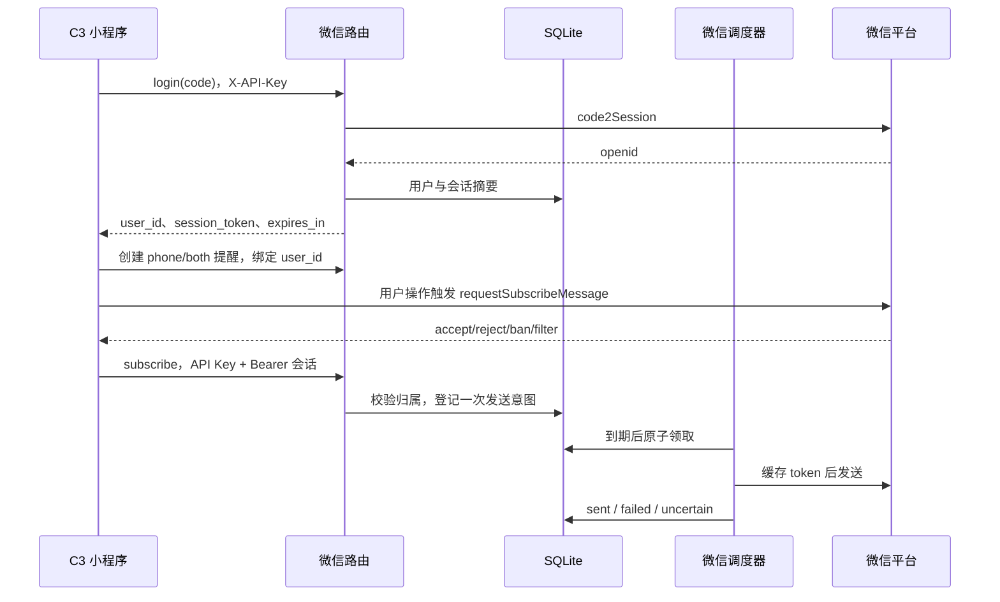
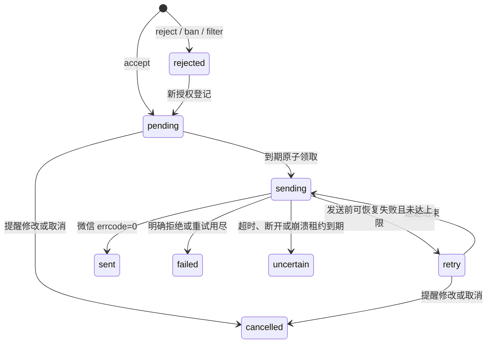

# B3 微信登录与一次性订阅消息

关联 [Issue #7](https://github.com/Yunkimo/Intelligent-Desktop-Pet/issues/7)。B3 提供后端接口、持久化发送状态和 Mock 验收；C3 小程序界面、微信账号资格与真机接收需要后续联调。

## 1. 架构与边界



`WeChatClient` 适配微信 HTTP，`wechat_store` 管理事务与状态，`WeChatDispatcher` 决定重试，路由负责输入与鉴权。`PushService.send_wechat_msg` 使用注入的适配器；测试替换 transport 和时钟，不替换业务状态机。WebSocket 和微信各有独立后台循环，慢微信请求不会占住桌面扫描循环。

当前项目使用共享 `X-API-Key`，持有它的成员仍能操作全局 CRUD，是受信任的课程演示环境。新增 Bearer 会话只限制微信订阅与订阅查询；不能据此宣称全系统已支持公网多租户隔离。不得把共享管理 Key 随公开小程序发布；公网开放前需统一用户级 CRUD 权限、限流及 HTTPS。现有 `pc` 提醒不受微信配置影响。

## 2. 配置与运行

使用现有后端环境，无新增运行依赖。在被忽略的 `backend/.env` 配置下表，模板见 `backend/.env.example`；不要覆盖已有个人配置。

| 参数 | 默认值 | 说明 |
|---|---|---|
| `WX_ENABLED` | `false` | 显式启用微信渠道 |
| `WX_APPID`、`WX_SECRET` | 空 | 对应小程序的身份与服务端凭证 |
| `WX_TEMPLATE_ID` | 空 | 账号实际可用的订阅消息模板 |
| `WX_TEMPLATE_FIELDS` | `{}` | JSON 字段映射，示例 `{"thing1":"title","time2":"remind_at"}` |
| `WX_MINIPROGRAM_STATE` | `developer` | `developer`、`trial` 或 `formal` |
| `WX_TIMEOUT_SECONDS` | `10` | 单次 HTTP 请求上限，正有限秒数 |
| `WX_SESSION_TTL_SECONDS` | `7200` | 本地登录会话有效期，60 至 86400 秒 |

字段名必须匹配真实模板。目前支持 `thingN` 对应 `title`/`body`，`timeN` 对应 `remind_at`；文本取前 20 个字符，时间按 `REMINDER_NAIVE_OFFSET_MINUTES` 显示。其他字段类型尚未实现，不能套用示例假装模板兼容。缺少身份配置时微信接口返回 503；缺少模板或映射时订阅返回 503。

在仓库根目录激活后端虚拟环境后运行：

```powershell
python -m pip install -r backend/requirements-dev.txt
python -m uvicorn app.main:app --app-dir backend --host 127.0.0.1 --port 8000 --workers 1
```

健康检查：`GET /api/health`；交互接口说明：`http://127.0.0.1:8000/docs`。保留单 worker 限制，token 缓存是进程内缓存；同一 AppID 不应由多个独立实例竞争刷新。`SCHEDULER_ENABLED=false` 会停止两条后台渠道；联调建议 `SCHEDULER_INTERVAL_SECONDS=1`。服务默认 30 秒扫描，不承诺微信五秒到达。

## 3. C3 接口契约

2026-10-18：C3 新客户端使用带会话的事务创建/复用入口，不再自行 GET 后 POST 管理提醒。新增当前事件字段、本人提醒查询和消息跳转见 [C3 增量契约](c3-subscription.md)。下文保留旧管理接口的兼容用法；同一时刻的格式变化不生成新事件，日程改期/删除与旧提醒失效现已由同一事务处理。订阅登记和历史查询的返回字段新增 event_id，C3 登记时一并提交它以防跨事件重放。

所有以下请求均携带 `X-API-Key`；订阅和订阅查询还需 `Authorization: Bearer <session_token>`。凭证放请求头，不放 URL、截图或日志。

### 登录

`POST /api/wechat/login`，请求 `{"code":"由 wx.login 获取的新 code"}`。成功响应：

```json
{"user_id":1,"openid":"微信用户标识","session_token":"服务端生成的随机会话","expires_in":7200}
```

响应带 `Cache-Control: no-store`。同一 AppID/openid 重复登录复用 user_id、撤销旧会话；本地库只保存 SHA-256 会话摘要。openid 不是密码，接口不会返回 `session_key`、AppSecret 或微信 access_token。code 失效返回 401；上游不可用或畸形响应返回脱敏 502。

### 提醒归属与授权

登录后，受信任客户端通过现有 `POST /api/reminders` 创建提醒，将 `wechat_user_id` 设为该次登录的 user_id：

```json
{"title":"课程提醒","body":"带好资料","remind_at":"2026-10-15T10:00:00+08:00","channel":"phone","wechat_user_id":1}
```

时间示例需换成实际未来时间。用户主动点击后由 C3 调用 `wx.requestSubscribeMessage`，再将对应模板的真实选择登记到 `POST /api/wechat/subscribe`：

```json
{"reminder_id":1,"request_id":"00000000-0000-4000-8000-000000000001","template_id":"账号实际模板 ID","result":"accept"}
```

每次新登记生成新的 UUID；同一次网络重试复用原 request_id。返回字段为 `request_id`、`reminder_id`、`choice`、`status`、`attempts`、`last_error`。`accept` 初始状态为 pending，其余 `reject/ban/filter` 为 rejected，不发送。客户端报告 accept 只代表登记意图，实际权限由微信最终判断。

| 情况 | HTTP / 行为 |
|---|---|
| 缺失或错误 API Key / Bearer 会话 | 401 |
| 非本人提醒或不存在 | 404 |
| 原 request_id、内容和事件一致 | 200，返回同一记录，不追加发送 |
| request_id 内容变化或同一事件重复登记 | 409 |
| 仅 pc 渠道、提醒已完成 | 409 |
| 模板不匹配、额外 openid 字段、非 UUID、非法收件人 ID | 422 |
| 先拒绝，后重新同意 | 未完成的同一提醒允许新 request_id 转 pending；旧登记被替换 |

`GET /api/wechat/subscriptions/{reminder_id}` 只返回本人当前仍拥有的提醒的订阅历史，无记录或非本人时返回空数组。管理诊断 `GET /api/reminders/{id}/delivery` 保留 B2 字段，新增 `wechat` 数组。

## 4. 状态、重试与完成语义



- token 在过期前刷新，并发刷新通过锁合并。微信明确返回 40001/40014/42001 时只刷新并重试一次；再次拒绝终止。
- 发送前获取 token 的网络故障、HTTP 错误或系统繁忙可按 `SCHEDULER_MAX_ATTEMPTS` 有限重试，默认三次，沿用 B2 退避参数。
- 43101（无订阅）、40037（模板错误）、47003（字段错误）等明确拒绝为 failed。发送请求超时、响应不完整、取消或发送成功后写库失败均可能已消耗订阅机会，标为 uncertain，不自动重发。
- 微信 `sent` 只说明平台接受请求，不证明手机已展示。uncertain 需先核对平台与手机，再重新创建提醒并重新授权；不能直接改库恢复 pending。
- `pc` 沿用 B2；`phone` 仅微信成功后设 done=1；`both` 的 done 继续由桌面成功驱动，微信状态独立。桌面先成功仍可发送此前已登记的微信意图；微信先成功不会取消桌面重试。不要以单一 done 推断双渠道均成功。
- 修改提醒会生成新事件，旧待发授权取消；新事件需要重新登记。删除提醒级联删除订阅。发送前复查事件与归属，但请求发出后的并发修改无法撤回平台消息。

## 5. 数据迁移与部署恢复

启动幂等创建 `wechat_users`（含 AppID 隔离）、`wechat_sessions`、`wechat_subscriptions`，为 reminders 增加可空外键 `wechat_user_id`，记录迁移版本 2。原 B2 事件 ID、到期时间和状态不重写。已有 phone/both 提醒不会自动绑定任何人，也不会自动获得授权。

B3 不自动生成升级备份。升级前停止写入，按 [B2 备份与恢复步骤](b2-scheduler.md) 对实际 DB_PATH 做 SQLite 一致性备份，先在副本验证迁移。回滚时停止服务并还原升级前备份；不要将业务数据库、会话、openid 或备份提交到 Git。默认数据目录已忽略，自定义 DB_PATH 也应放仓库外并限制文件权限。

部署按 [C 端任务书](tasks/C-miniprogram-deploy.md) 继续落实，本节单 worker、环境变量和健康检查为 B3 增量要求；公网证书、白名单、合法域名与平台账号能力由部署及 C3 联调确认。

## 6. 演示与真机验收

无需微信凭证的重复验收，在仓库根目录、后端环境中执行：

```powershell
python scripts/smoke_backend_wechat.py --samples 30
python -m pytest -c backend/pytest.ini backend/tests/test_wechat.py -q
```

脚本使用真实应用、临时 SQLite 和 MockTransport，验证登录、登记重放、到期调度、缓存和完成状态，不修改个人数据库，不发送真实消息。完整证据见 [B3 测试报告](b3-test-report.md)。

C3 真机步骤：配置实际账号与模板 → 登录并创建本人未来提醒 → 点击授权 → 登记授权结果 → 关闭桌面客户端 → 保持后端在线 → 到期后核对平台状态与手机消息。分别记录同意、拒绝、权限不足的现象，拍摄脱敏视频，记录设备、微信版本、网络、提醒时间及接收时间。当前尚未执行这些真机步骤。

对照入口：[登录](https://developers.weixin.qq.com/miniprogram/dev/OpenApiDoc/user-login/code2Session.html)、[token](https://developers.weixin.qq.com/miniprogram/dev/OpenApiDoc/mp-access-token/getAccessToken.html)、[发送](https://developers.weixin.qq.com/miniprogram/dev/OpenApiDoc/subscribe-message/sendMessage.html)。本次工具未能读取这些官方页面，不能把 Mock 验证当作对当前平台政策、账号资格或真实模板的核验；上线前由 B/C 使用账号后台和官方文档复核。
