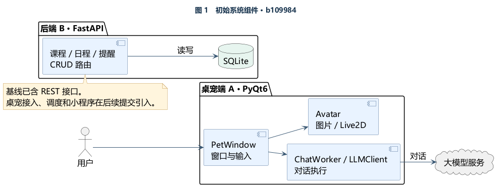
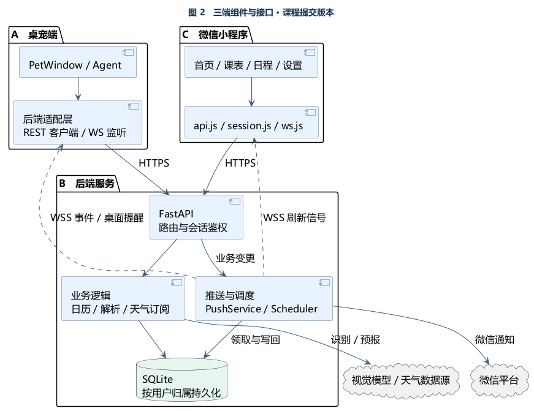
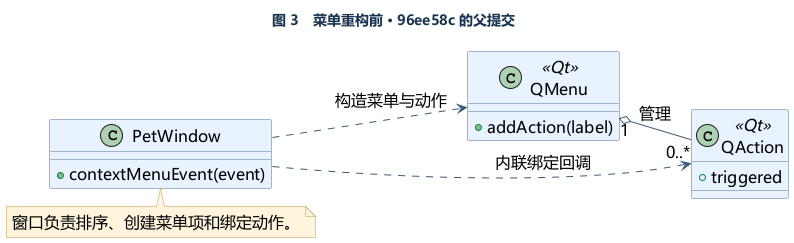
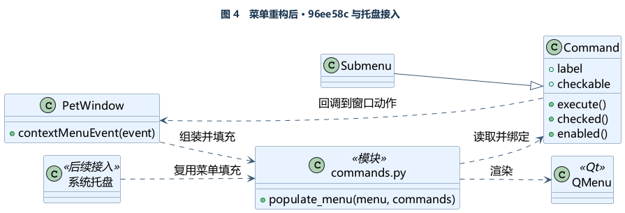
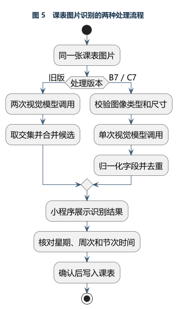
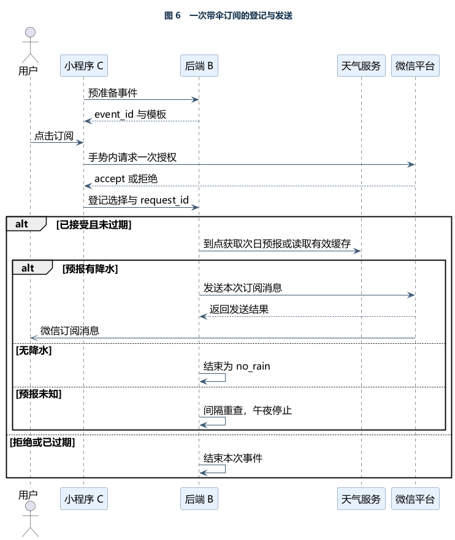
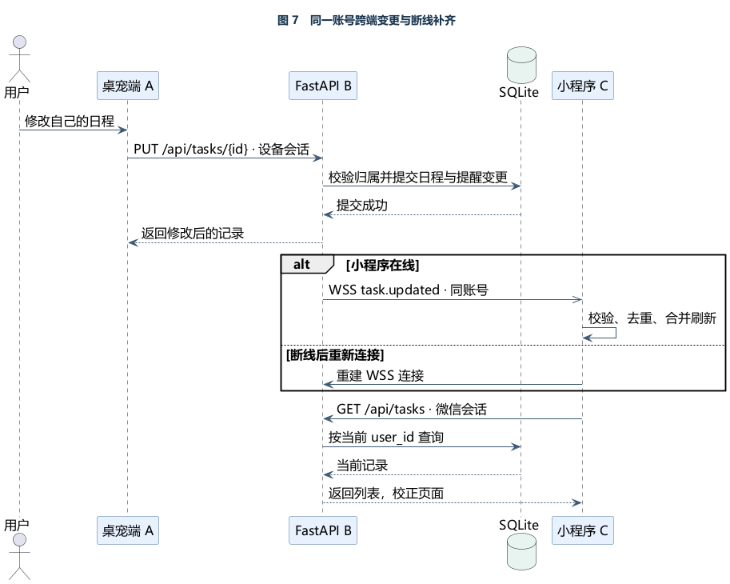

# 智能桌宠课程设计与开发说明

**项目** Intelligent Desktop Pet　｜　**团队** A 桌宠端 · B 后端 · C 微信小程序与部署协作  
**文档日期** 2026-11-05　｜　**系统快照** `develop@0d0fc06`

[代码 Git 仓库](https://github.com/Yunkimo/Intelligent-Desktop-Pet) · [课程系统源码快照](https://github.com/Yunkimo/Intelligent-Desktop-Pet/tree/0d0fc06a7f2baa64476fdebe42a332f3e09105b5) · [考核证据索引](https://github.com/Yunkimo/Intelligent-Desktop-Pet/blob/0d0fc06a7f2baa64476fdebe42a332f3e09105b5/docs/assessment-evidence.md)

项目把桌面对话、课表与日程、到期提醒和手机查询连接到同一套后端。课程、日程、提醒及学期设置以服务端记录为准。桌宠保留形象、对话交互和本地习惯等客户端职责，小程序负责手机端查询、编辑和微信授权。

## 1. 重构前后的系统

### 1.1 初始基线

团队以 `b109984` 为可复查的早期系统。桌宠以窗口、对话执行与形象渲染为主，后端已经有课程、日程、提醒的 REST 读写和 SQLite 存储。此时桌宠的业务 API 适配、WebSocket 广播、后端到期调度与微信小程序尚未接入。初始基线已经采用模型与形象抽象，属于已有设计。[b109984](https://github.com/Yunkimo/Intelligent-Desktop-Pet/commit/b109984)



*图 1　以首次导入项目的代码为依据。箭头表示调用或依赖。*

### 1.2 三端协作结构

桌宠通过后端客户端查询和修改业务数据，通过 WSS 接收提醒。小程序统一封装请求、会话和实时事件，收到变更信号后重新读取列表。后端负责鉴权、数据存储、事务联动和调度，并通过独立外部接口调用视觉模型、天气来源和微信平台。三端演进包含模块重构与新能力交付，后文分别给出证据。



*图 2　按 A、B、C 划分组件职责。虚线表示通知方向，实线表示调用。图中视觉模型与天气来源为外部依赖，微信平台也为小程序登录提供身份。*

| 成员 | 主要交付 | 三端协作边界 |
| --- | --- | --- |
| A · Yunkimo | PyQt6 桌宠、Agent 工具、菜单命令化、语音和气泡、设备账号绑定、桌面带伞提醒 | 通过 REST/WSS 使用业务数据，负责桌面展示与本地配置 |
| B · wwweiliang | 实时事件、调度、微信订阅、天气与搜索、日程联动、学期日历、解析、用户隔离和配对 | 定义接口、数据归属、提醒生命周期与后端验证口径 |
| C · YingboQi | 小程序页面与适配层、课表导入、日程草稿、微信授权、账号接入及部署协作 | 负责手机交互、状态恢复、真机验收与部署文档 |

## 2. A 端设计重构

### 2.1 菜单动作抽取为命令对象

**动机与思路。** 早期右键菜单在 `PetWindow.contextMenuEvent` 里直接创建 Qt 动作并绑定回调。菜单项顺序、勾选状态与窗口行为挤在同一个入口。托盘接入后也需要触发窗口动作，因此把菜单项本身表示为命令，把 Qt 菜单填充集中到一个模块。



*图 3　窗口依赖 Qt 菜单和 QAction，在事件方法中完成组装与绑定。*

**方法。** `Command` 保存标签、执行回调、勾选与可用状态，`Submenu` 复用命令列表的排列方式。`populate_menu` 将命令转换成 Qt 菜单项。右键与后续托盘入口复用填充逻辑，命令触发时回调窗口方法。[96ee58c](https://github.com/Yunkimo/Intelligent-Desktop-Pet/commit/96ee58c) · [PR #53](https://github.com/Yunkimo/Intelligent-Desktop-Pet/pull/53)



*图 4　空心三角表示继承，虚线表示依赖。托盘复用在命令模块引入后接入。*

**效果。** 抽出 54 行命令模块，并新增 8 个测试验证顺序与勾选状态等行为。`window.py` 从 571 行变为 585 行，收益体现在动作描述可复用、可独立验证。[重构量化报告](https://github.com/Yunkimo/Intelligent-Desktop-Pet/blob/0d0fc06a7f2baa64476fdebe42a332f3e09105b5/docs/refactor-report.md)

### 2.2 收敛形象渲染与依赖

团队主要使用图片和动图形象，因此移除 Live2D 路径及 PyQt6-WebEngine 依赖，保留图片形象。该提交删 1,902 行、新增 14 行，按整次提交统计净减少 1,888 行，`avatar.py` 从 135 行降到 63 行。此次调整也移除了 Live2D 功能，属于伴随功能取舍的依赖精简。行数包含素材和文档。[3a25324](https://github.com/Yunkimo/Intelligent-Desktop-Pet/commit/3a25324)

## 3. B 端架构演进与关键实现

| 改造 | 动机与思路 | 实现与效果 |
| --- | --- | --- |
| B1–B3 实时与调度 | 基线具备数据读写，跨端变更和到期投递需要统一处理 | WebSocket 负责在线事件，调度器领取到期记录并记录状态，微信客户端封装外部发送。可注入时钟和 HTTP 传输，便于测试重试和幂等。[PR #16](https://github.com/Yunkimo/Intelligent-Desktop-Pet/pull/16) · [接口契约](https://github.com/Yunkimo/Intelligent-Desktop-Pet/blob/0d0fc06a7f2baa64476fdebe42a332f3e09105b5/docs/api-contract.md) |
| B5 日程和提醒 | 保存日程与安排提醒需要一致，改期后旧计划需要失效 | 日程与关联 PC 提醒在 SQLite 事务中一起变更。完成、清空或删除时终止旧计划。每周提醒完成后推进下一周期，周期采用新事件 ID，微信授权按周期登记。[PR #80](https://github.com/Yunkimo/Intelligent-Desktop-Pet/pull/80) · [PR #98](https://github.com/Yunkimo/Intelligent-Desktop-Pet/pull/98) |
| B6 学期日历 | 固定周缓存容易跨周失准，桌宠和手机需要一致的周次 | 由学期首周日期、总周数和时区计算当前周及今日课表。批量导入完成后发出一次刷新信号。[PR #86](https://github.com/Yunkimo/Intelligent-Desktop-Pet/pull/86) · [B6 核验](https://github.com/Yunkimo/Intelligent-Desktop-Pet/blob/0d0fc06a7f2baa64476fdebe42a332f3e09105b5/docs/b6-verification.md) |
| B7 解析 | 图片解析调用开销高，自然语言需要先校正再创建 | 图像走受限输入与单次模型调用，缺失字段交给用户确认。文本解析先给日程草稿，小程序确认后才保存。[PR #90](https://github.com/Yunkimo/Intelligent-Desktop-Pet/pull/90) · [PR #93](https://github.com/Yunkimo/Intelligent-Desktop-Pet/pull/93) |
| B8 账号隔离 | 共享凭据适合演示，个人数据需要区分归属 | 微信会话、桌宠设备会话关联同一业务用户。小程序向后端申请五分钟一次性配对码，桌宠兑换设备会话。业务按 `user_id` 约束查询和 WS 投递，越权资源返回 404。迁移保留历史数据归属。[PR #94](https://github.com/Yunkimo/Intelligent-Desktop-Pet/pull/94) · [B8 账号契约](https://github.com/Yunkimo/Intelligent-Desktop-Pet/blob/0d0fc06a7f2baa64476fdebe42a332f3e09105b5/docs/b8-accounts.md) |

### 3.1 调度延迟的验证口径

B2 把到期记录的领取、租约恢复和有限退避放入后台调度器。重试沿用同一 `event_id`，客户端用它识别重复事件。B 的本地记录对比了 1 秒与 30 秒扫描，两组各发送并收到 30 条。到期到本地 WS 收包的 P95 分别为 **0.948 秒**和 **27.944 秒**，反映扫描间隔对等待时间的影响。实际气泡绘制用第 5 节的 C4 数据衡量。[1 秒扫描原始结果](https://github.com/Yunkimo/Intelligent-Desktop-Pet/blob/0d0fc06a7f2baa64476fdebe42a332f3e09105b5/docs/evidence/b2/latency-1s.json) · [30 秒扫描原始结果](https://github.com/Yunkimo/Intelligent-Desktop-Pet/blob/0d0fc06a7f2baa64476fdebe42a332f3e09105b5/docs/evidence/b2/latency-30s.json)

### 3.2 B7 图片识别前后对照

旧链路以两次视觉调用及结果交集稳定候选。B7 减少模型往返，后端对结果做确定性校验与归一化。样例原图没有标时刻，B7 将缺项交给 C7 按标准节次预填，用户可在写入前修改。



*图 5　两种处理路径在用户确认环节汇合。提交到课表发生在确认之后。*

| 测量口径 | 旧版 | B7 |
| --- | ---: | ---: |
| 解析中位耗时 | 45.946 秒 | 17.450 秒 |
| 解析最大耗时 | 120.263 秒 | 28.638 秒 |
| 成功次数 | 5/5 | 5/5 |
| 样例核心字段匹配 | 每次 14/14 | 每次 14/14 |

同一张 14 格合成课表、同一 DeepSeek-V4.1-Flash 模型，两版各跑 5 次，解析中位耗时降低 **62.02%**。表内耗时包含模型调用，适用于该样例与当次网络条件。报告还记录过一次新版约 60 秒的失败，手机端总等待时间另行测量。[B7 服务器基准与原始耗时](https://github.com/Yunkimo/Intelligent-Desktop-Pet/blob/0d0fc06a7f2baa64476fdebe42a332f3e09105b5/docs/b7-server-verification.md)

### 3.3 带伞提醒的三端分工

B4 提供联网查询基础，B5 补充按城市和目标日期缓存的次日天气，后续 B 的微信订阅接入独立登记和调度。桌宠依据客户端配置查询并显示气泡。小程序提供天气卡片、城市切换、订阅与事件详情。天气描述按天气代码生成中文，上游异常返回未知状态。[PR #98](https://github.com/Yunkimo/Intelligent-Desktop-Pet/pull/98) · [PR #103](https://github.com/Yunkimo/Intelligent-Desktop-Pet/pull/103) · [PR #104](https://github.com/Yunkimo/Intelligent-Desktop-Pet/pull/104) · [PR #105](https://github.com/Yunkimo/Intelligent-Desktop-Pet/pull/105)



*图 6　小程序先准备事件，在用户点击时请求微信授权。后端在上海时区晚间按本次事件判断。微信平台受理和手机实收分别验证。*

登记用同一个 `request_id` 恢复结果，降低网络丢响应后重复登记的风险。后端遇到明确降水才进入发送，无降水结束，天气未知按间隔重查至午夜。发送结果不明时记录 `uncertain`，避免自动重发。[天气订阅契约](https://github.com/Yunkimo/Intelligent-Desktop-Pet/blob/0d0fc06a7f2baa64476fdebe42a332f3e09105b5/docs/weather-subscriptions.md)

## 4. C 端适配与跨端一致性

C1 先统一请求入口。随着页面增加，C2 把连接、校验、去重、合并刷新、断线重连与前后台生命周期集中到 `utils/ws.js`。C9 再将登录、单次会话恢复、退出以及过期请求拦截集中到 `utils/session.js`，学期缓存按账号区分。改造后页面按事件触发读取，断线重连后再用 REST 列表补齐，避免把短暂在线事件当作完整记录。[9a494a3](https://github.com/Yunkimo/Intelligent-Desktop-Pet/commit/9a494a3) · [PR #95](https://github.com/Yunkimo/Intelligent-Desktop-Pet/pull/95) · [PR #97](https://github.com/Yunkimo/Intelligent-Desktop-Pet/pull/97)



*图 7　以桌宠修改日程为例。后端完成事务后发布变更，在线页面与重连页面均通过 REST 获得当前数据。*

小程序对模型输出采用草稿确认。C7 支持终止上传、识别后检查时间和周次、保存失败后恢复草稿。C8 把一句话拆成可修改的日程草稿，并在逐项保存时处理失败。C6 用服务端日历对齐当前周，弱网场景用已缓存的学期参数做日期推算。[PR #87](https://github.com/Yunkimo/Intelligent-Desktop-Pet/pull/87) · [PR #91](https://github.com/Yunkimo/Intelligent-Desktop-Pet/pull/91) · [PR #92](https://github.com/Yunkimo/Intelligent-Desktop-Pet/pull/92)

## 5. 验证结果与证据

2026-11-05 在 `0d0fc06` 的隔离源码副本复跑，桌宠 **405 项通过**，后端 **387 项通过**，小程序 **9/9 个逻辑测试文件通过**。后端出现一条 Starlette/httpx 弃用提示。下表保留各阶段验收的提交和测试口径，便于区分自动化回归、接口联调和人工观察。

| 验证场景 | 结果 | 可追溯证据 |
| --- | --- | --- |
| A 桌宠回归 | A 交接记录在 `0d0fc06` 报告 405 项通过，包含命令、语音、账号、习惯与交互 | [菜单命令测试](https://github.com/Yunkimo/Intelligent-Desktop-Pet/blob/0d0fc06a7f2baa64476fdebe42a332f3e09105b5/tests/test_commands.py) · [测试说明](https://github.com/Yunkimo/Intelligent-Desktop-Pet/blob/0d0fc06a7f2baa64476fdebe42a332f3e09105b5/docs/testing.md) |
| B5 事务与调度 | 阶段记录后端 268 项通过，1 秒扫描下 30/30 条 WS 接收，0 超时与重复 | [B5 核验记录](https://github.com/Yunkimo/Intelligent-Desktop-Pet/blob/0d0fc06a7f2baa64476fdebe42a332f3e09105b5/docs/b5-verification.md) |
| B6 多端同步 | 两个 WS 客户端各收到同样 7 条事件，5 门课批量导入发 1 条刷新信号 | [B6 核验记录](https://github.com/Yunkimo/Intelligent-Desktop-Pet/blob/0d0fc06a7f2baa64476fdebe42a332f3e09105b5/docs/b6-verification.md) |
| B8 双用户隔离 | 阶段后端 334 项通过，隔离环境中验证双用户 HTTP/WS、配对重放与撤销 | [B8 核验记录](https://github.com/Yunkimo/Intelligent-Desktop-Pet/blob/0d0fc06a7f2baa64476fdebe42a332f3e09105b5/docs/b8-verification.md) |
| B 微信带伞 | B 部署阶段记录后端 380 项通过，含新增订阅测试 23 项。C 收尾日志另记真机收到消息并点击落地页 | [PR #105](https://github.com/Yunkimo/Intelligent-Desktop-Pet/pull/105) · [天气部署核验](https://github.com/Yunkimo/Intelligent-Desktop-Pet/blob/0d0fc06a7f2baa64476fdebe42a332f3e09105b5/docs/weather-push-deployment-20261104.md) · [C 侧接口联调记录](https://github.com/Yunkimo/Intelligent-Desktop-Pet/blob/0d0fc06a7f2baa64476fdebe42a332f3e09105b5/docs/evidence/c-weather/c-weather-verification.md) |
| C 小程序回归 | C 交接记录 9 个逻辑测试文件全过。C6/C7/C8/C9 真实后端集成分别 11/5/5/7 项通过 | [小程序测试入口](https://github.com/Yunkimo/Intelligent-Desktop-Pet/blob/0d0fc06a7f2baa64476fdebe42a332f3e09105b5/miniprogram/package.json) · [C9 核验](https://github.com/Yunkimo/Intelligent-Desktop-Pet/blob/0d0fc06a7f2baa64476fdebe42a332f3e09105b5/docs/evidence/c9/c9-verification.md) |
| 公网至桌面提醒 | C4 联调 5/5 条 PC 提醒实际绘制，最慢延迟上界 2.069 秒。使用 1 秒扫描、单客户端、当轮 HTTP/WS 测试环境 | [C4 时延报告与原始样本](https://github.com/Yunkimo/Intelligent-Desktop-Pet/blob/0d0fc06a7f2baa64476fdebe42a332f3e09105b5/docs/evidence/c4/desktop-latency-20261025.md) |


*图 8　C4 存档中的第一条桌面测试气泡，用于佐证可见绘制。完整报告记录了扫描间隔、时钟误差与样本范围。*

## 6. 运行、测试与交付

1. **桌宠端。** 在 Windows 按仓库 README 执行 `setup.bat`，从 `.env.example` 复制配置并填写所需模型和后端参数，再运行 `启动桌宠.bat`。
2. **本地后端。** 在 `backend` 创建 Python 虚拟环境，安装 `requirements.txt`，按示例配置 `.env`，执行 `python run.py`。使用 `GET /api/health` 核对服务状态。
3. **微信小程序。** 使用微信开发者工具导入 `miniprogram`，配置后端地址。微信登录、订阅授权和消息实收需要已配置的微信环境。正式部署采用 Nginx 处理 HTTPS/WSS，systemd 管理后端，SQLite 数据库升级和恢复使用备份。[部署手册](https://github.com/Yunkimo/Intelligent-Desktop-Pet/blob/0d0fc06a7f2baa64476fdebe42a332f3e09105b5/docs/deploy.md)
4. **自动化。** 在对应依赖环境中，从仓库根目录运行以下命令。CI、评审和提交规范见仓库文档。[测试说明](https://github.com/Yunkimo/Intelligent-Desktop-Pet/blob/0d0fc06a7f2baa64476fdebe42a332f3e09105b5/docs/testing.md) · [CI 说明](https://github.com/Yunkimo/Intelligent-Desktop-Pet/blob/0d0fc06a7f2baa64476fdebe42a332f3e09105b5/docs/ci.md) · [贡献指南](https://github.com/Yunkimo/Intelligent-Desktop-Pet/blob/0d0fc06a7f2baa64476fdebe42a332f3e09105b5/CONTRIBUTING.md)

```bash
python -m pytest tests
python -m pytest -c backend/pytest.ini backend/tests
npm test --prefix miniprogram
```

教师可按「小程序配对 → 桌宠绑定 → 桌宠修改日程 → 小程序刷新 → 到期桌宠弹出提醒」复核跨端链路。微信带伞提醒可另选有降水预报的城市，授权后检查事件状态及手机实收。

本文参考成员 A 的 `handover-A.md`、成员 B 的 `IDP.docx`、`IDP2.docx` 与 B 本地工作日志，以及成员 C 单独提供的 `worklog.local.md`。代码和测试证据链接到仓库版本。七张 UML 图附可编辑的 PlantUML 源文件。[UML 目录](uml/)
