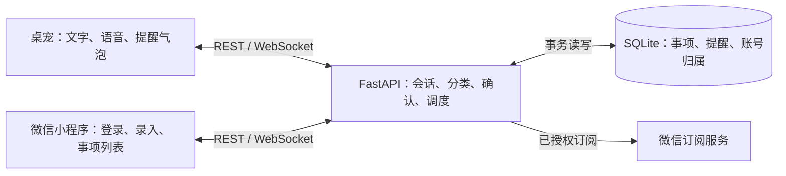

# 智能桌宠重构报告：从旧版桌宠到 V2

## 1. 对照基线

| 对照对象 | 固定版本 | 用途 |
| --- | --- | --- |
| 旧桌宠 | [Old-Intelligent-Desk-Pet `db47243`](https://github.com/Yunkimo/Old-Intelligent-Desk-Pet/tree/db4724398b42cdf3a3106c61db4955ae24d9d689) | 旧仓库 `main` 快照 |
| 新桌宠 | [Intelligent-Desktop-Pet V2.0.0](https://github.com/Yunkimo/Intelligent-Desktop-Pet/releases/tag/v2.0.0)，[源码 `a11a420`](https://github.com/Yunkimo/Intelligent-Desktop-Pet/tree/a11a4204a1298fd0f1f924b1a349ebaf677ea364) | V2 发布快照 |
| 演进节点 | [新仓库基线 `b109984`](https://github.com/Yunkimo/Intelligent-Desktop-Pet/commit/b109984) | 查验桌宠代码继承关系及后端的初始边界 |

旧版已经是模块化的 PyQt6 桌宠，具备文字与语音对话、人设、历史、Sprite 和 Live2D 形象。旧版 `Settings` 已分开读取 `.env` 与 `config.json`，`ChatProvider` 已抽象模型接口，聊天、转写、播报也已经由 Qt 后台线程处理。新仓库导入基线与旧版有 22 个同路径的 `pet/` Python 文件，统一 CRLF 与 LF 后其中 10 个内容相同。下文以旧仓库快照为对照，早期原型另见 [设计文档](design.md)。

V2 延续桌面交互，把跨设备的待办、日程、提醒与账号归属集中到后端，并增加微信小程序。报告分别衡量桌宠内部重构、三端扩展和功能实验。

## 2. 桌宠内部重构

| 改动 | 旧版做法 | V2 的落点及效果 |
| --- | --- | --- |
| 菜单动作抽取 | `PetWindow.contextMenuEvent` 在窗口内构建动作并绑定回调 | `Command` 与 `populate_menu` 分离菜单呈现和动作定义，桌面右键和托盘入口可复用动作。 [命令实现](../pet/commands.py) · [命令测试](../tests/test_commands.py) |
| 形象渲染收敛 | Sprite 与 Live2D 共存，后者经 Qt WebEngine 加载前端运行时 | 保留 `Avatar` 接口和 Sprite 渲染，移除 Live2D、WebEngine 及相关配置。V2 支持图片帧动画，旧 Live2D 模型需要换成受支持的形象素材。 [形象实现](../pet/avatar.py) · [移除提交](https://github.com/Yunkimo/Intelligent-Desktop-Pet/commit/3a25324) |
| 配置与模型接口 | 已使用双源配置和模型策略，温度和最大 token 已由配置提供 | 新仓库初始导入时这两项使用固定值，后续恢复了配置注入。V2 再把后端地址和运行凭据分到各端环境。 [桌宠配置](../pet/config.py) · [模型接口](../pet/providers.py) · [配置化提交](https://github.com/Yunkimo/Intelligent-Desktop-Pet/commit/88fefac) |
| 气泡计算可测试 | 已有独立的折行函数 `wrap_text` | 保留折行函数，并将屏幕摆位提取为 `bubble_placement`。选择提示有单独状态，普通提示超时后仍可保持选择气泡。 [气泡实现](../pet/bubble.py) · [确认交互测试](../tests/test_capture_prompt.py) |

## 3. 从本地桌宠到三端协作

旧仓库没有 `backend/` 和 `miniprogram/`。V2 中，桌宠保留语音、对话和桌面呈现，小程序负责微信登录、文字录入和事项列表。FastAPI 统一管理事项分类、会话、SQLite 持久化及提醒调度。客户端经 REST 提交和读取数据，经 WebSocket 接收所属账号的变更事件。微信订阅由后端调用平台接口。 [API 契约](api-contract.md) · [账号设计](b8-accounts.md)



以「明天下午三点交报告」为例。两个客户端都请求 `POST /api/capture`，后端按规则将其分类为待办，并返回提前提醒选项，默认建议提前 1 小时。用户确认后，待办与关联提醒在事务中写入。请求按账号和 `request_id` 记录，重复确认复用已有结果。WebSocket 事件按账号投递，小程序收到变更后重新读列表。分类规则、确认和鉴权的维护集中在服务端。 [录入实现](../backend/app/capture.py) · [推送实现](../backend/app/push_service.py) · [录入回归](../backend/tests/test_capture.py)

后端通过构造注入测试微信和网络适配器。双账号冒烟使用真实的本地 HTTP 与 WebSocket，微信身份由本地替身提供，覆盖配对码单次使用、会话撤销及跨账号隔离。 [后端组装](../backend/app/main.py) · [双账号冒烟](../scripts/smoke_backend_accounts.py)

## 4. 量化结果

### 两个仓库的快照对比

| 指标 | 旧仓库 `db47243` | 新仓库 V2 `a11a420` |
| --- | ---: | ---: |
| 桌宠 `pet/` Python 文件 / 物理行 | 23 / 2,127 | 42 / 6,539 |
| 后端 `backend/app/` Python 文件 / 物理行 | 0 / 0 | 38 / 5,189 |
| 小程序 `miniprogram/` JS 文件 / 物理行（含测试） | 0 / 0 | 37 / 7,144 |
| 桌宠 `tests/test_*.py` 文件 / 测试函数 | 12 / 48 | 45 / 402 |
| 后端 `backend/tests/test_*.py` 文件 / 测试函数 | 0 / 0 | 20 / 224 |
| `assets/live2d/` 文件 / 字节 | 23 / 10,293,338 | 0 / 0 |
| `assets/` 文件 / 字节 | 26 / 17,536,059 | 5 / 743,363 |

`assets/` 未压缩字节数下降 **95.76%**，包含 Live2D 下线和其他素材调整。表中数字描述源码快照的体积和测试规模。安装包大小、内存占用及启动耗时需要另测。桌宠源码和窗口类随功能增加而扩大，`pet/window.py` 从 472 行增至 1,197 行。后续可优先拆分该类中的账号连接和录入状态协调。

### 可定位到单个提交的收益

| 提交 | 可核对变化 |
| --- | --- |
| [`96ee58c` 菜单命令化](https://github.com/Yunkimo/Intelligent-Desktop-Pet/commit/96ee58c) | 新增 54 行命令模块及 109 行回归测试。窗口文件由 571 行变为 585 行，收益是动作可复用和独立验证。 |
| [`3a25324` 移除 Live2D](https://github.com/Yunkimo/Intelligent-Desktop-Pet/commit/3a25324) | 22 个文件共增加 14 行、删除 1,902 行，**净减少 1,888 行**。`avatar.py` 从 135 行降至 63 行，运行依赖移除 `PyQt6-WebEngine`。 |
| [`88fefac` LLM 参数配置化](https://github.com/Yunkimo/Intelligent-Desktop-Pet/commit/88fefac) | 将新仓库导入基线中的两个固定值改回由 `Settings` 提供，恢复旧仓库已有的配置能力。 |

### V2 功能实验

- **课表识别**。在新仓库的 B7 优化前后，用同一张 14 格合成课表、同一模型各测 5 次。中位耗时从 45.946 秒降至 17.450 秒，下降 62.02%，每次 14 格核心字段均匹配。对照版本是 B7 优化前的识别服务。 [实验记录](b7-server-verification.md)
- **桌宠提醒**。单客户端、调度间隔 1 秒的联调中，5/5 条提醒绘制出气泡，最慢一条计入时钟差后的延迟上界为 2.069 秒。 [时延记录](evidence/c4/desktop-latency-20261025.md)
- **账号隔离与回归**。V2 发布提交的桌宠、小程序、部署文档和两种 Python 版本后端共 5 个 CI 任务通过。账号隔离另有双账号真实 HTTP/WS 冒烟。旧版没有这些跨端链路，功能实验分别按各自报告条件解读。 [V2 CI](https://github.com/Yunkimo/Intelligent-Desktop-Pet/actions/runs/42465570187) · [复现环境](environment.md)

## 5. 复核方法

在分别克隆的两个仓库的父目录按固定提交导出快照。以 ZIP 内文件清单为准，目录项剔除。旧版 GitHub 源码包有一层仓库名目录，比较前去掉这层前缀。

```bash
git -C Old-Intelligent-Desk-Pet archive --format=zip -o ../idp-old.zip db4724398b42cdf3a3106c61db4955ae24d9d689
git -C Intelligent-Desktop-Pet archive --format=zip -o ../idp-v2.zip a11a4204a1298fd0f1f924b1a349ebaf677ea364
git -C Intelligent-Desktop-Pet show --shortstat 3a25324
git -C Intelligent-Desktop-Pet show --numstat 96ee58c
```

源码行按 UTF-8 解码后用 `splitlines()` 统计，包含空行和注释。Python 测试函数用 AST 统计 `test_*.py` 中以 `test_` 开头的函数及方法，参数化用例按一个函数计。素材字节累加 ZIP 中各文件的未压缩字节数。后续评估启动时间或内存时，应在同一机器、相同依赖和等价形象配置下采样，再分别报告中位数与波动范围。
